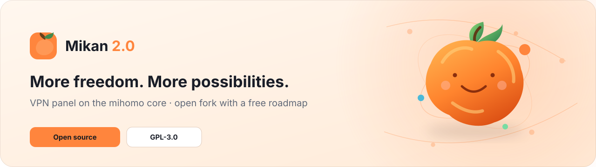

<div align="center">

<picture>
  <source media="(prefers-color-scheme: dark)" srcset=".github/assets/banner-en-dark.svg">
  
</picture>

<br>

**Mikan 2.0 is an open Mikan fork with a free roadmap and its own release process.**

[](https://github.com/m0ruy0/mikan-2.0)
[](LICENSE)
[](https://github.com/MetaCubeX/mihomo)

[Русский](README.ru.md) · **English**

</div>

---

## One-command installer

> **The first Mikan 2.0 release has not been published yet.** The command below is for the upcoming stable release; do not run it on a production server yet.

On a clean Ubuntu 22.04+ or Debian 12+ VPS (amd64/arm64), after the first signed release is published:

```bash
curl -fsSL https://github.com/m0ruy0/mikan-2.0/releases/latest/download/install.sh | sudo bash
```

The installer will verify the signed release manifest and the downloaded binary's SHA-256 checksum before starting the setup wizard. Do not use the original Mikan installer or image for Mikan 2.0.

Read the [installation guide](https://m0ruy0.github.io/mikan-2.0/en/start/install/).

## What we are building

- **Pterodactyl nodes** — an Egg for regular game hosting without root or a Docker socket inside the container. Compatibility will depend on the provider's TCP/UDP allocations.
- **Addon marketplace** — multiple ready-made Telegram bots, payment adapters and integrations with scoped permissions and verifiable updates.
- **API for custom bots** — documented endpoints, scoped keys and signed webhooks.
- **Free core features** — panel migration, safely importing external subscriptions as nodes, and a separate Telegram admin bot.

These capabilities are still roadmap items, not a finished release. See the full [Mikan 2.0 roadmap](docs/mikan20-roadmap.md).

## Development

The base is derived from [Mikan](https://github.com/Miroshka000/mikan), and the original attribution notices are retained. Mikan 2.0 is a modified fork under GNU GPL v3, not an official upstream release.

Development currently happens on `main`. Installer changes must be checked with Go tests, web/site builds and Rust tests; no release is considered ready until validation passes.

## License

[GNU GPL v3](LICENSE). Commercial use and redistribution are permitted under the license terms.
