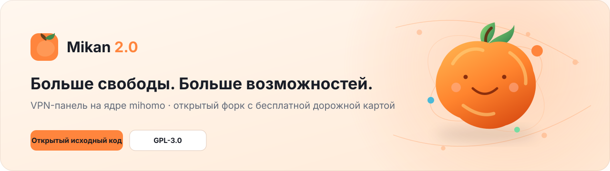

<picture>
  <source media="(prefers-color-scheme: dark)" srcset=".github/assets/banner-ru-dark.svg">
  
</picture>

 

**Mikan 2.0 — открытый форк Mikan с бесплатной дорожной картой и собственным релизным процессом.**

**Русский** · [English](README_EN.md)

---

## Быстрый старт

> **Важно:** первый подписанный релиз Mikan 2.0 ещё не опубликован. Команда установки ниже станет рабочей после подготовки release secret и успешного выпуска. Пока не запускай её на production-сервере.

На чистом VPS с Ubuntu 22.04+ или Debian 12+ (amd64/arm64) после публикации релиза установка будет выполняться одной командой:

~~~bash
curl -fsSL https://github.com/m0ruy0/mikan-2.0/releases/latest/download/install.sh | sudo bash
~~~

Установщик проверяет подпись манифеста релиза и SHA-256 скачанного бинарника, прежде чем запустить мастер настройки. Не используй установщик или Docker-образ оригинального Mikan для Mikan 2.0.

**Документация:** [установка](https://m0ruy0.github.io/mikan-2.0/start/install/) · [возможности исходной панели](https://m0ruy0.github.io/mikan-2.0/start/overview/) · [все протоколы](https://m0ruy0.github.io/mikan-2.0/protocols/presets/)

## Что уже есть в основе

- **Ноды на VPS/VDS** — отдельные узлы панели, статистика и управление подключениями.
- **mihomo и множество протоколов** — пресеты конфигурации и учёт трафика в поддерживаемых протоколах.
- **Подписки для разных приложений** — отдельные форматы для совместимых VPN-клиентов.
- **Telegram-бот и Mini App** — управление подписками и поддерживаемые платежные адаптеры.
- **Тарифы, устройства и промокоды** — базовые функции управления клиентами.
- **Обновления и резервные копии** — существующая инфраструктура исходного проекта, адаптируемая для форка.

## Что добавим бесплатно в Mikan 2.0

| Возможность | План |
|---|---|
| Ноды на Pterodactyl | Egg для игрового хостинга без root и Docker socket внутри контейнера; поддержка зависит от TCP/UDP-портов провайдера. |
| Магазин аддонов | Несколько готовых Telegram-ботов, платёжные адаптеры и сторонние интеграции. |
| API для своих ботов | Документированный API, ключи с ограниченными правами и webhooks. |
| Внешние подписки как ноды | Безопасная загрузка и обновление источников с сохранением последней рабочей конфигурации. |
| Перенос панели | Резервная копия, проверка восстановления и возможность отката. |
| Админ-бот Telegram | Роли, список разрешённых администраторов и аудит действий. |

Это **дорожная карта**, а не утверждение, что перечисленные функции уже реализованы. Полный план находится в [docs/mikan20-roadmap.md](docs/mikan20-roadmap.md).

## Разработка и релизы

Основа проекта унаследована от [Mikan](https://github.com/Miroshka000/mikan). Mikan 2.0 — модифицированный форк под GNU GPL v3, не официальный релиз авторов оригинального проекта. Уведомления об авторстве и лицензии сохраняются.

- [Код Mikan 2.0](https://github.com/m0ruy0/mikan-2.0)
- [Релизы](https://github.com/m0ruy0/mikan-2.0/releases)
- [Дорожная карта](docs/mikan20-roadmap.md)
- [Настройка подписанных релизов](docs/releasing.md)

Перед релизом должны проходить Go-тесты, проверки web/site и Rust-тесты. Подписанные релизы нельзя публиковать, пока не настроен секрет RELEASE_SIGNING_KEY и все CI-проверки не завершены успешно.

## Лицензия

[GNU GPL v3](LICENSE). Коммерческое использование и распространение допускаются на условиях лицензии.
